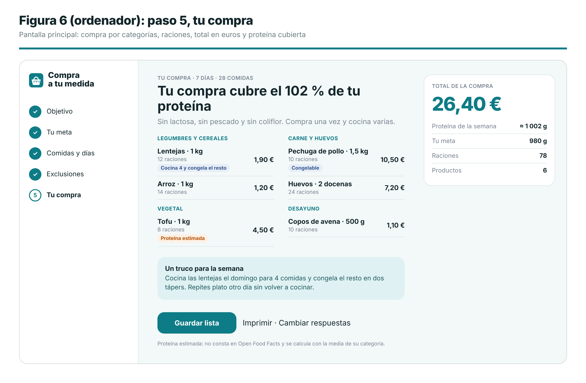
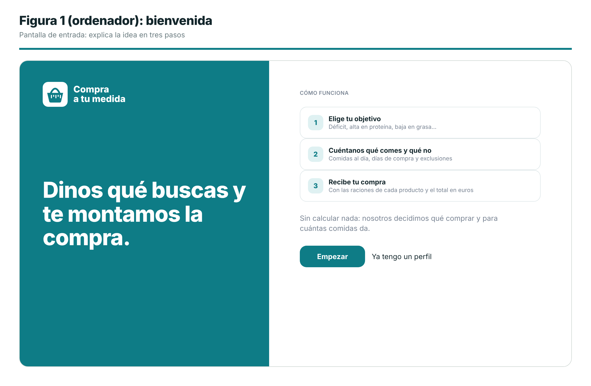
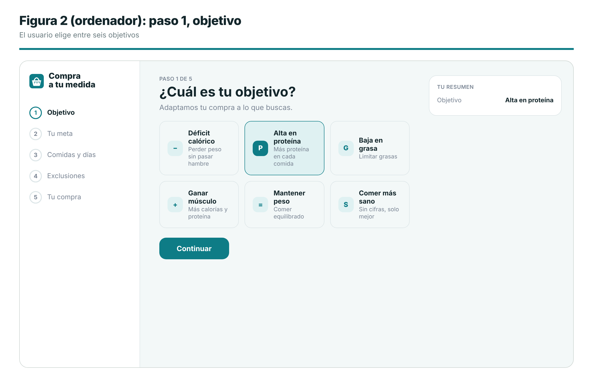
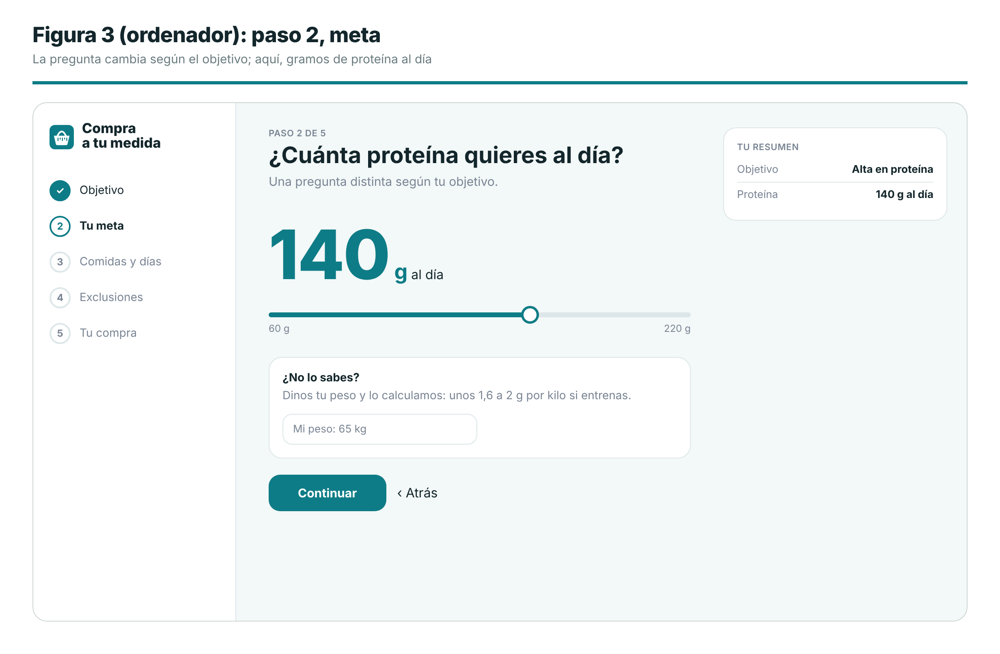
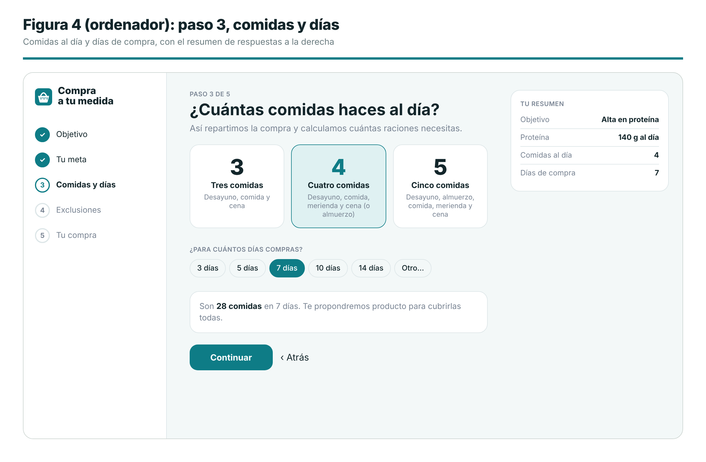
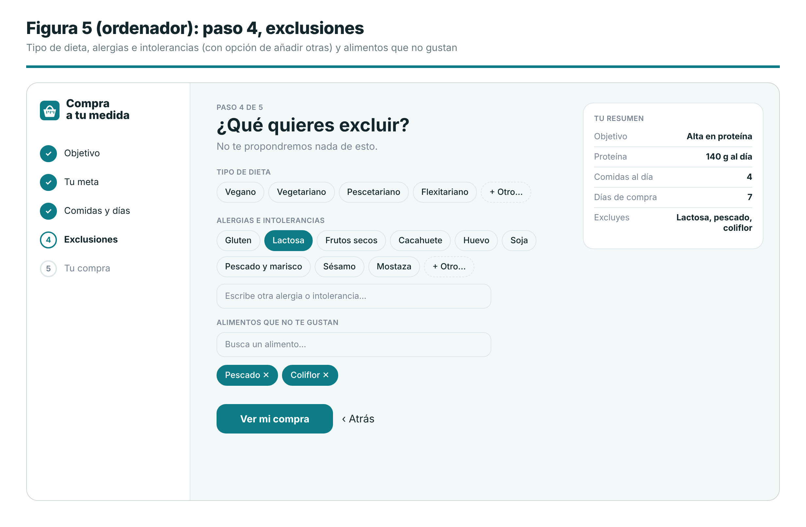
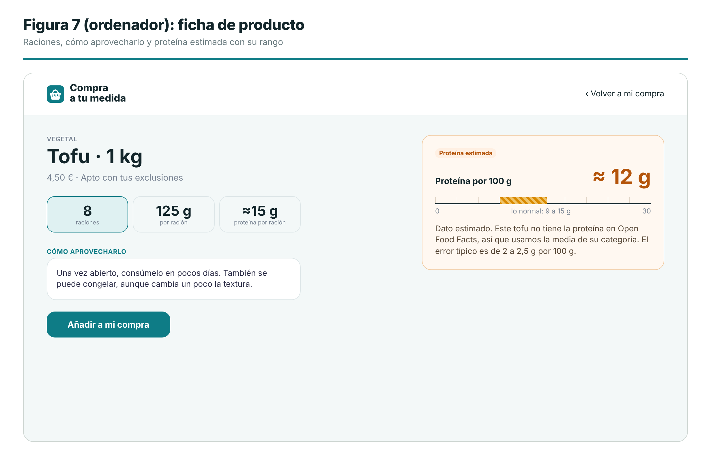
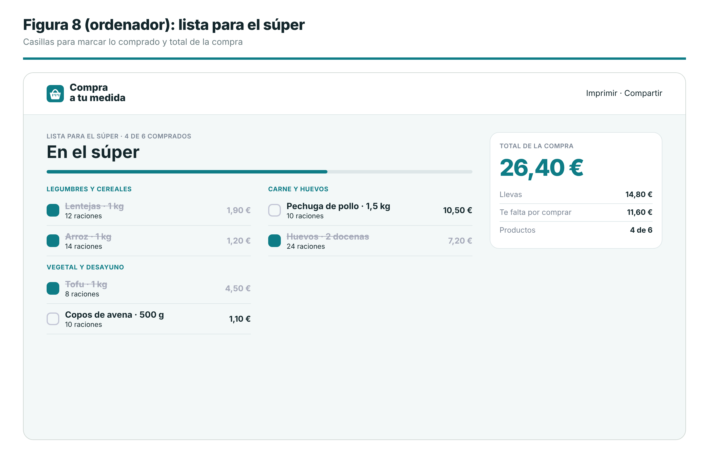
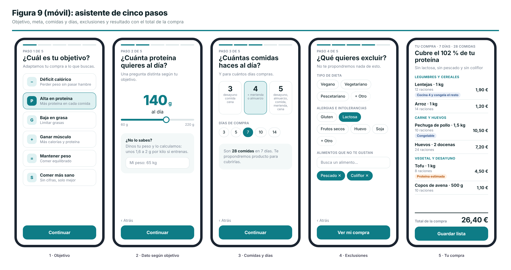
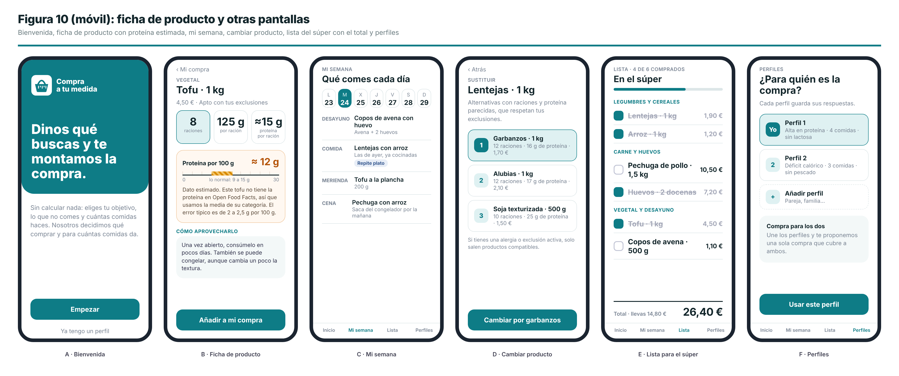

# Entrega 4 - Diseño del frontal y experiencia de usuario

Nombre de trabajo del producto: **Compra a tu medida**.

## 1. Utilidad y valor del producto

**A quién me dirijo.** A personas que siguen un objetivo nutricional (perder peso, comer más proteína, reducir grasa) y hacen la compra en Mercadona, sin tiempo ni ganas de calcular a mano si lo que compran encaja con ese objetivo. Empiezo por mí y por mi pareja, que hacemos dieta, pero he diseñado la herramienta pensando en alguien que no sabe de nutrición.

**Qué problema resuelve.** Hacer la compra a ojo no asegura cumplir el objetivo, y calcularlo producto a producto es tedioso. La herramienta convierte el objetivo en una compra concreta, con productos reales de Mercadona.

**Qué hará el MVP.**

- Un asistente de cinco preguntas: el objetivo, un dato que depende del objetivo (por ejemplo, los gramos de proteína al día), cuántas comidas se hacen al día (3, 4 o 5), cuántos días se compra y qué se quiere excluir (tipo de dieta, alergias e intolerancias y alimentos que no gustan).
- Una compra propuesta, agrupada por categorías, con las raciones de cada producto, el total en euros y cuánto del objetivo cubre.
- Una ficha de cada producto que explica cuántas raciones da, cómo aprovecharlo (cocinar de una vez, congelar) y, si su proteína es una estimación, cómo de fiable es.
- Una lista para el supermercado, con casillas para ir marcando lo comprado.

**Qué podrá decidir la persona.** Qué comprar y cuánto para cubrir su objetivo durante toda la semana, cuántas comidas le da cada producto, qué puede cocinar de una vez y congelar para repetir, y si la compra se ajusta a lo que quiere gastar.

**Un cambio respecto a las entregas anteriores.** En la entrega 3 mi métrica principal era la proteína por euro y trabajaba con el estado del producto (seco, cocinado, fresco). Al diseñar la pantalla vi que a quien compra no le aportan nada: quiere saber qué comprar y para cuántas comidas. Por eso esos conceptos pasan a un segundo plano. El modelo y los datos siguen trabajando por detrás, pero la persona ve raciones, euros y avisos sencillos. Solo dejo visible lo que sí importa para fiarse del resultado: cuando la proteína de un producto es una estimación y no un dato de la etiqueta.

## 2. Flujo de usuario

La persona entra y responde a una pregunta por pantalla. Al final recibe su compra ya montada. Prioricé un flujo corto y lineal, sin registro ni configuraciones previas.

| Paso | Qué selecciona o introduce | Qué recibe |
|---|---|---|
| 1. Objetivo | Déficit calórico, alta en proteína, baja en grasa, ganar músculo, mantener peso o comer más sano | La siguiente pregunta, adaptada al objetivo |
| 2. Su meta | Un dato que cambia según el objetivo (ver tabla de abajo) | Su meta diaria, que puede calcularse con su peso si no la sabe |
| 3. Comidas y días | Comidas al día (3, 4 o 5) y días de compra | El número total de comidas que hay que cubrir |
| 4. Exclusiones | Tipo de dieta, alergias o intolerancias y alimentos que no le gustan | La garantía de que no verá productos excluidos |
| 5. Su compra | Nada, solo revisar | La compra por categorías con raciones, el total en euros y el porcentaje del objetivo cubierto |

La pregunta del paso 2 depende del objetivo elegido:

| Objetivo | Pregunta del paso 2 |
|---|---|
| Déficit calórico | Calorías al día |
| Alta en proteína | Gramos de proteína al día (o su peso, para calcularlos) |
| Baja en grasa | Límite de grasa al día |
| Ganar músculo | Calorías y proteína al día |
| Mantener peso | Calorías al día |
| Comer más sano | Ninguna: se pasa directamente al paso 3 |

**Qué puede hacer después.** Entrar en la ficha de un producto para ver sus raciones y cómo aprovecharlo, guardar o imprimir la lista, cambiar sus respuestas y volver a calcular, y llevar la lista al supermercado marcando cada producto al comprarlo.

## 3. Diseño del frontal

He diseñado la herramienta en dos versiones, ordenador y móvil, con el mismo flujo y el mismo estilo. Los mockups están hechos en HTML con productos y cifras de ejemplo inventados: no son datos reales de Mercadona.

### Pantalla principal

Es la pantalla en la que llega todo el trabajo de las entregas anteriores. Muestra estas funcionalidades esenciales:

- La compra propuesta, agrupada por categorías, con las raciones que da cada producto y su precio.
- Avisos sencillos para aprovechar la compra, como "cocina 4 y congela el resto" o "congelable".
- Un resumen a la derecha con el total en euros, la proteína de la semana frente a la meta, las raciones y los productos.
- Acciones para guardar o imprimir la lista y para cambiar las respuestas.

**Cómo presento los datos y el resultado del modelo.** La proteína de la mayoría de productos viene de Open Food Facts y se muestra sin más. Cuando un producto no tiene ese dato, mi modelo de la entrega 3 lo estima con la media de su categoría y estado. En ese caso el producto lleva la etiqueta naranja "proteína estimada", y el total de proteína de la semana se escribe con "≈" porque incluye al menos una estimación. En la ficha del producto (Figura 7) se explica de dónde sale el número y cuál es su rango habitual: "lo normal: 9 a 15 g". Ese rango viene de la regla por categoría y estado de la entrega 3 (−3,2 y +3,5 g para el 80 % de los casos), y el error típico de 2 a 2,5 g es el que medí con las etiquetas reales.

### Recorrido por el resto de pantallas

**Versión de ordenador.**

**Versión móvil.** Es la misma idea adaptada a una pantalla pequeña, con una pregunta por pantalla y botones grandes, pensada para usarla también en el supermercado.

Las pantallas adicionales de la Figura 10 (mi semana, cambiar producto y perfiles) son ideas que no entran en el MVP; las explico en el apartado 5.

## 4. Experiencia de usuario

Estas son las decisiones de diseño que he tomado y por qué.

### Claridad de la información

- **Una pregunta por pantalla, con barra de progreso.** El asistente tiene cinco pasos y la persona siempre ve en cuál está. Así no tiene que entender un formulario largo, y puede volver atrás sin perder lo que ya respondió.
- **Raciones y euros en vez de gramos por 100 g.** A quien compra no le dice nada "24 g de proteína por 100 g", pero sí "12 raciones por 1,90 €". Por eso la pantalla principal habla de raciones, precio y porcentaje del objetivo cubierto.
- **Un titular que resume el resultado.** La pantalla de la compra empieza con "tu compra cubre el 102 % de tu proteína", y el total en euros está siempre a la vista en el resumen.
- **Datos técnicos en un segundo nivel.** La proteína por producto, su origen y su rango solo aparecen en la ficha del producto, para quien quiera comprobarlos.

### Controles y gráficos elegidos

- **Tarjetas grandes para elegir** (objetivo, comidas al día): son pocas opciones y se ven todas a la vez, sin menús desplegables.
- **Deslizador y campo de peso** para la meta: la persona puede escoger una cifra directamente o dejar que la herramienta la calcule con su peso.
- **Chips para exclusiones y días de compra:** se seleccionan con un toque y se ve de un vistazo lo que está activo. Cada grupo tiene una opción "otro…" para lo que no esté en la lista.
- **Casillas en la lista del súper**, para marcar lo comprado mientras se hace la compra.
- **Muy pocos gráficos, a propósito.** Solo hay dos: una barra de progreso (en la lista del súper) y una barra de rango en la ficha de producto, que enseña el valor estimado y su margen. No hay gráficos de dispersión ni tablas de datos, porque no ayudan a decidir qué comprar.

### Facilidad de uso

- **Se adapta al objetivo.** La pregunta del paso 2 cambia según lo elegido, y si la persona escoge "comer más sano" no se le pide ninguna cifra.
- **Versión móvil pensada para el supermercado:** botones grandes, un solo contenido por pantalla y lista con casillas.
- **El color tiene un solo significado.** El verde azulado es la acción principal, el naranja se usa únicamente para lo estimado, y los consejos ("congelable") van en azul grisáceo. Además, lo estimado nunca depende solo del color: lleva el texto "proteína estimada" y el símbolo "≈".

### Gestión de errores y resultados inciertos

- **Las estimaciones se ven siempre.** Un producto cuya proteína no está en Open Food Facts lleva la etiqueta "proteína estimada", y el total de proteína de la semana se escribe con "≈". En la ficha se explica de dónde sale el número ("la media de su categoría") y su rango habitual, con el error típico de 2 a 2,5 g por 100 g que medí con etiquetas reales.
- **No se inventan números.** Si un producto pertenece a un grupo donde mi regla no es fiable (menos de 8 productos de comparación o error de validación cruzada mayor de 4 g), no se le muestra proteína y no cuenta para el total.
- **Las exclusiones mandan.** Si la persona marca una alergia o intolerancia y de un producto no tengo información de ingredientes, no se lo ofrezco. Aun así, la herramienta avisa de que conviene revisar la etiqueta, porque los datos de ingredientes no son infalibles.
- **Si la compra no llega al objetivo,** por ejemplo porque las exclusiones dejan pocas opciones, se muestra el porcentaje real cubierto y un aviso con lo que falta, en lugar de fingir que llega.
- **Si una categoría se queda sin productos compatibles,** se indica claramente ("no hay productos compatibles en esta categoría con tus respuestas") en vez de dejarla vacía.
- **Valores límite en la meta.** El deslizador solo permite cifras razonables (por ejemplo, de 60 a 220 g de proteína al día) para evitar entradas absurdas.

## 5. Continuidad hacia el MVP final

### Qué implementaré en el MVP funcional (9 de diciembre)

- **Asistente de cinco pasos:** objetivo, meta, comidas y días de compra, exclusiones y compra final.
- **Compra por categorías**, con las raciones de cada producto, el total en euros y el porcentaje de la meta cubierto.
- **Ficha de producto** con la proteína, su origen (dato de Open Food Facts o estimación) y el rango habitual.
- **Lista para el súper** con casillas para marcar lo comprado.
- **Aviso de resultado incierto:** etiqueta "proteína estimada" y "≈" en el total cuando haya estimaciones.

### Qué dejo como mejora futura

| Idea | Por qué no entra en el MVP |
|---|---|
| Mi semana (reparto de comidas por día) | Necesita reglas adicionales para combinar productos en comidas concretas |
| Cambiar un producto por otro equivalente | Hay que definir cuándo dos productos son equivalentes |
| Perfiles y compra para dos personas | Multiplica las reglas de exclusiones y de raciones |
| Escáner de código de barras | Depende de una cámara y de enlazar cada código con mis datos |

Las he dibujado en la Figura 10 para enseñar hacia dónde podría crecer la herramienta, pero no las voy a programar para el MVP.

### Cómo conecta la interfaz con los datos y el modelo

- **Datos:** la aplicación leerá la tabla Gold ampliada de la entrega 3, con los 269 productos, su precio, su categoría y su estado.
- **Proteína:** usará el dato de Open Food Facts cuando exista. En los 115 productos que no lo tienen aplicará la estimación por categoría y estado, y solo cuando la regla cumpla mi criterio de fiabilidad (al menos 8 productos de comparación y error de validación cruzada de 4 g o menos). Si no cumple, el producto no muestra proteína y no suma en el total.
- **Selección de la compra:** será un algoritmo basado en reglas (objetivo, meta, comidas y días, exclusiones y presupuesto). No usaré IA generativa.
- **Cosas que todavía tengo que construir:**
  - Una tabla hecha a mano con las raciones y si es congelable, por categoría.
  - La extracción de alérgenos e ingredientes de los datos de Open Food Facts que ya tengo descargados, que ahora mismo no están en la tabla Silver.
  - Una regla de seguridad: a quien declare una alergia o intolerancia no le ofreceré productos de los que no tenga información de ingredientes.
- **Tecnología:** pienso programar la aplicación con Streamlit, porque permite montar un asistente por pasos en Python reutilizando los notebooks y las tablas que ya tengo.

### Riesgos que veo

- Si no me da tiempo a construir la tabla de raciones para todas las categorías, el MVP cubrirá solo las más importantes.
- Los datos de alérgenos de Open Food Facts no son infalibles, por eso la aplicación avisará de que conviene revisar siempre la etiqueta.